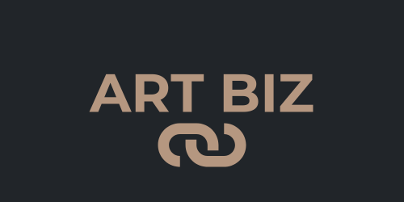

# ART BIZ
 
Art Biz is a fictitious B2B art consulting and event booking platform, created as part of the Full Stack Software Development program at Code Institute.

## Table of Contents
+ [UX](#ux)
  + [Background & Inspiration](#background--inspiration)
  + [Site Purpose](#site-purpose)
  + [Site Goal](#site-goal)
  + [Business Strategy](#business-strategy)
  + [Target Market](#target-market)
  + [Agile Methodology & User Stories](#agile-methodology--user-stories)
+ [Data Models & Database Architecture](#data-models--database-architecture)
+ [Design](#design)
  + [Wireframes](#wireframes)
  + [Colour Scheme](#colour-scheme)
  + [Typography](#typography)
  + [Imagery](#imagery)
+ [Features](#features)
  + [Existing Features](#existing-features)
  + [Future Features](#future-features)
+ [Testing](#testing)
  + [Manual & CRUD Testing](#manual--crud-testing)
  + [Validator Testing](#validator-testing)
  + [Unfixed Bugs](#unfixed-bugs)
+ [Technologies Used](#technologies-used)
  + [Main Languages Used](#main-languages-used)
  + [Frameworks, Libraries & Programs Used](#frameworks-libraries-programs-used)
+ [Deployment](#deployment)
+ [Credits](#credits)
  

## UX

### Background & Inspiration
For several years, I worked as a practicing artist and ran my own art gallery in one of Stockholm's largest shopping malls, selling both my own work and pieces by fellow artists. Through my experience in the industry, I know firsthand how difficult it is for artists to break through commercially without a traditional five-year fine arts degree or an exhaustive focus on personal branding on social media.

While unforeseen health challenges eventually forced me to step back from running the physical gallery, the next natural evolution of my business concept was always to bridge the B2B market—giving artists a fair platform to showcase and sell their work, while helping companies create vibrant, inspiring workspaces. 

In this project, fictional artists and events are used to demonstrate the platform's core Minimum Viable Product (MVP). However, the system architecture is specifically designed to scale seamlessly with future add-on features for both artists and corporate clients.

### Site Purpose
Art Biz is a full-stack web application designed to bridge the gap between contemporary artists and corporate clients. The platform allows businesses to browse curated art services, explore featured artists, and book creative workshops, art rentals, or consulting sessions online.

### Site Goal
* Provide a seamless and intuitive booking experience for corporate clients.
* Offer full **CRUD (Create, Read, Update, Delete)** functionality so users can manage their bookings and company profiles independently.
* Ensure responsive design and accessibility across desktop, tablet, and mobile devices.

### Business Strategy
Art Biz operates on a **B2B (Business-to-Business)** model, offering corporate art subscriptions, office installations, and creative team-building events. By centralizing artist portfolios and service bookings in one digital platform, Art Biz streamlines client onboarding and reduces administrative overhead.

### Target Market
* **Primary Audience:** Corporate decision-makers, office managers, and HR teams looking to enhance their workplace environment or host creative corporate events.
* **Secondary Audience:** Contemporary artists seeking corporate exposure and structured commercial collaborations.

### Agile Methodology & User Stories
This project was developed using **Agile principles** via GitHub Projects (Kanban board) to plan, prioritize, and track user stories across sprints.
* **MoSCoW Prioritization** was applied to categorize features into *Must Have*, *Should Have*, *Could Have*, and *Won't Have* to ensure a functional Minimum Viable Product (MVP) before adding enhancements.
* *(INSERT MY SCREENSHOT ).*

## Data Models & Database Architecture

The application is built on a relational database architecture (**PostgreSQL** in production, **SQLite** during local development) structured into three modular Django apps (`booking`, `artists`, and `subscriptions`). This separation of concerns ensures scalability and prevents namespace collisions as the platform grows with more artists and corporate contracts. 
MVC Framework	|	

### Key Models & Relationships
* **User & UserProfile (`subscriptions` app):** Extends Django's built-in `User` model (`first_name`, `last_name`, `email`) via a **One-to-One relationship (`OneToOneField`)** to store B2B-specific data such as `company_name`.
* **Service (`booking` app):** Stores the different corporate art services and events available for booking (title, description, service type, capacity/pricing).
* **Booking (`booking` app):** Connects a `User` and a `Service` via **Foreign Keys (`ForeignKey`)**, recording `booking_date`, `number_of_participants`, `notes`, and `status` (*Pending*, *Confirmed*, *Cancelled*).
* **Artist (`artists` app):** Manages the portfolio and biographical details of represented artists.
*(INSERT MY RELATIONDRAWING ).*

## Design 
Wireframes were created during the planning phase to establish layout hierarchy and responsive behavior across viewports.

# Wireframes
|	Landingpage	|	 |
| :--- | :--- |
|	Our Service	|	 |
|	Events!	|	[Events](https://res.cloudinary.com/dj9sie6nl/image/upload/c_auto,h_300,w_300/WF_events_gjrofn.jpg) |
|	Artists	|	 |
|	Login	|	 |
|	Signup	|	 |
|	404	|	 |
|	Dashboard	|	 |
|	Content planning	|	 |

### Colour Scheme:

A minimalist, gallery-inspired palette was chosen to let the artwork stand out:
* **`#212529` (Dark Charcoal):** Used for the navigation bar, footer, and primary text to ensure high contrast and readability.
* **`#b59780` (Warm Taupe / Sand):** Used for primary headings (`H1`), accent borders, and call-to-action buttons (`btn-artbiz`).
* **`#4a4a4a` (Slate Grey):** Used for secondary headings, subtexts, and subtle UI elements.
* **`#ffffff` (Crisp White):** Used as the main background and card surface to create clean negative space.

### Typography
*Montserrat** was selected as the primary typeface for headings, navigation, buttons, and body text to give the platform a clean, modern, and editorial feel. Imported via **Google Fonts** with `sans-serif` as the fallback font.

### Imagery
Stock photography was sourced from **Canva's** free media library. All original artworks featured on the landing page and the *Art to Office* event page were created by and belong to myself , **Camilla Dahlström**. All visual assets are hosted and delivered via **Cloudinary** for optimized loading performance.

## Features

### Existing Features

#### Navigation Bar 
Dynamically adapts based on authentication state—displaying *Sign Up* and *Sign In* for visitors, and *Dashboard* and *Log Out* for authenticated users. Collapses into a hamburger menu on mobile devices.

#### Landing Page 
Features a full-width hero section introducing Art Biz's corporate value proposition, curated artwork previews, and clear call-to-action buttons.

#### Artists & Services Pages
Allows potential clients to browse available corporate art events, consulting packages, and represented artists.

#### Authentication (`django-allauth`)
Custom registration flow capturing `first_name`, `last_name`, and `company_name`, alongside secure login, logout, and email verification support.

#### User Dashboard (Full CRUD)
  - Create: Authenticated users can book new events or consulting sessions.
  - Read: View active and past bookings with real-time status badges (*Pending Approval*, *Confirmed*, *Cancelled*) alongside account details.
  - Update: Edit existing bookings or update personal and company profile information (`Edit Profile`).
  - Delete: Cancel bookings via a confirmation modal displaying the cancellation policy, or permanently delete the user account (`Delete Account`) with defensive confirmation prompts.
  - Admin Panel: Customized Django Admin interface displaying company names inline and in the user list overview for streamlined management.

### Future Features
  - Artist Portal: Allow verified artists to create their own accounts, upload new artworks directly to the gallery, and track exhibition requests.
  - Art Leasing & Subscription Management: Automated recurring billing (via Stripe) for companies subscribing to rotating office art collections.
  - Interactive Virtual Gallery: An augmented reality (AR) or room-visualizer tool enabling corporate clients to preview artworks on their own office walls before booking.
  - Automated Email Notifications: Instant booking confirmations and calendar invites sent automatically to both the client and the Art Biz team.

## Testing

### Manual & CRUD Testing
All features, forms, and user permissions were manually tested across desktop and mobile viewports:

| Feature | Action | Expected Result | Pass/Fail |
| :--- | :--- | :--- | :--- |
| **User Registration** | Sign up with First Name, Last Name, Email & Company Name | User and linked `UserProfile` created in database | Pass |
| **Create Booking** | Submit booking form while logged in | Booking saved and displayed on Dashboard as *Pending* | Pass |
| **Update Booking** | Edit date/participants on an existing booking | Updated details reflected immediately on Dashboard | Pass |
| **Cancel Booking** | Confirm cancellation in modal | Booking status updated / removed | Pass |
| **Edit Profile** | Update First Name, Last Name, or Company Name | Changes saved and displayed on Dashboard & Admin | Pass |
| **Delete Account** | Confirm permanent account deletion | User logged out and `User` + `UserProfile` deleted | Pass |
| **Defensive Security** | Access `/accounts/dashboard/` or `/profile/edit/` while logged out | Redirected to Login page | Pass |

### Validator Testing
* **HTML:** Validated via W3C Markup Validator — *"Document checking complete. No errors or warnings to show."*
* **CSS:** Validated via W3C Jigsaw CSS Validator — *"No error found."*
* **Python (PEP8):** Checked via CI Python Linter — *"All clear, no errors found."*
* **Lighthouse:** *(INSERT MY IMAGE).*

### Unfixed Bugs
* There are no known unfixed bugs at the time of submission.

## Technologies Used

### Main Languages Used
- HTML5
- CSS3
- JavaScript
- Python 3

### Frameworks, Libraries & Programs Used
- Django (v6.1.3)– High-level Python web framework used for MVT architecture, routing, and ORM.
- Django Allauth (v65.21.1) – Integrated user authentication, registration, and account management.
- Bootstrap 5 & Django-Bootstrap5 / Crispy Forms – Responsive grid system, cards, modals, and clean form styling.
- PostgreSQL (`psycopg2-binary` & `dj-database-url`)** – Relational database management in production.
- Cloudinary – Cloud-based image hosting and optimization.
- Gunicorn– Python WSGI HTTP server used to run the application in production.
- WhiteNoise– Static file serving directly from Django in production.
- Google Fonts– Typography, Font families:  Montserrat. San-serif was used as a default font.
- Font Awesome – Scalable vector icons for navigation, dashboard cards, and social links.
- Git & GitHub – Version control and Agile project tracking.
- Canva – Logo creation, colour palette design, and visual assets.
- Am I Responsive? – Multi-device responsiveness verification.
- Render  - Deployment
 
## Deployment

## Credits

### Content

- W3School Online Web Tutorials 
  https://www.w3schools.com/
  Useful tutorials with flexbox, css and styling of ste site.

- Codepen
  https://codepen.io/
  Useful inspiration and tutorials from user. 

- Canva
  https://www.canva.com/ 
  Images, presentations are made in canva.com
  Hero image and image at the welcomepage is taken from canva´s image library.

### Acknowledgements & Thank You
I began my studies at **Code Institute** in the autumn of 2023. Along the way, my family and I faced unexpected challenges that required me to put my own health and the well-being of my two sons first. 

I want to extend my deepest gratitude to **Code Institute**, my mentors, and the student support team for their flexibility, encouragement, and for giving me the opportunity to complete my education and reach my goal of becoming a **Full Stack Software Developer**.

