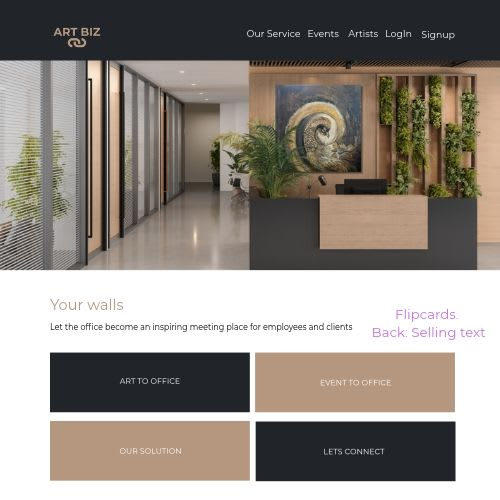
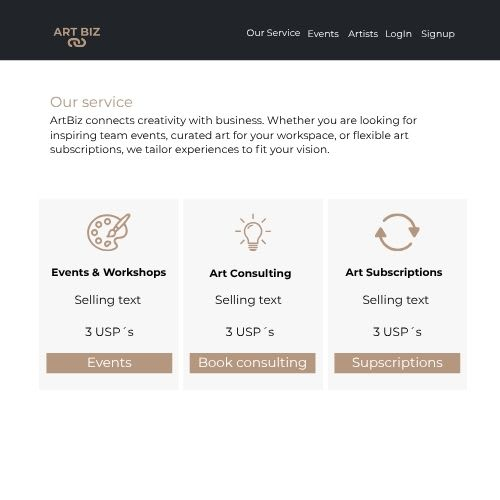
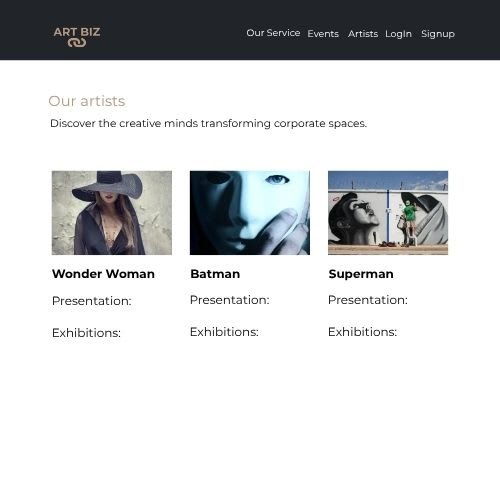
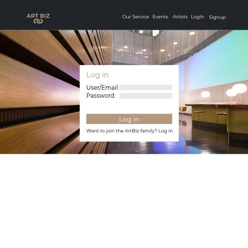
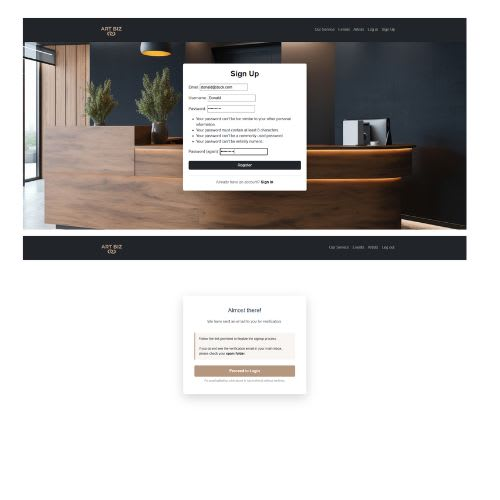
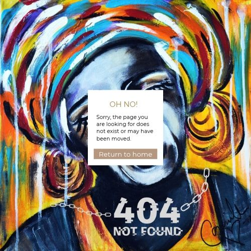
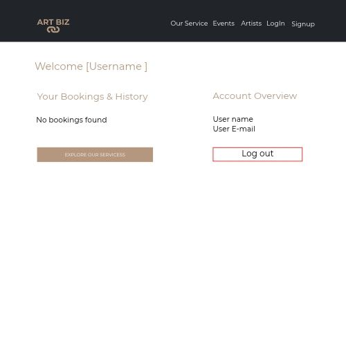
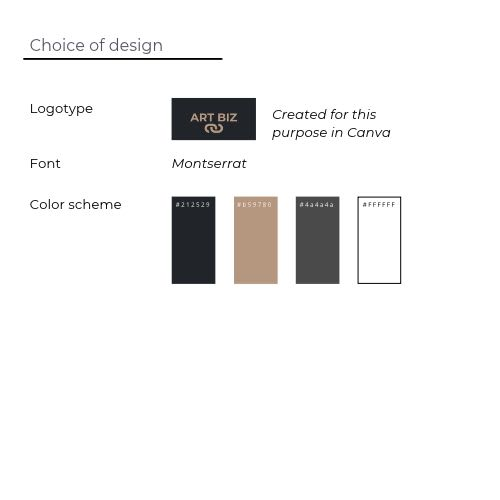

ART BIZ
Art Biz a fictitious company, created as part of project work at the Code Institute.

## Tabel of contents
+ [UX](#ux "UX")
  + [Site Purpose](#site-purpose "Site Purpose")
  + [Site Goal](#site-goal "Site Goal")
  + [Business Strategy](#business-strategy "Business Strategy")
  + [Target Market](#target-market "Target Market")
  + [Communication](#communication "Communication")
+ [Design](#design "Design")
  + [Wireframe](#wireframe "Wireframe")
  + [Colour Scheme](#colour-scheme "Colour Scheme")
  + [Typography](#typography "Typography")
  + [Imagery](#imagery "Imagery")
+ [Features](#features "Features")
  + [Existing Features](#existing-features "Existing Features")
+ [Testing](#testing "Testing")
  + [Validator Testing](#validator-testing "Validator Testing")
  + [Unfixed Bugs](#unfixed-bugs "Unfixed Bugs")
+ [Technologies Used](#technologies-used "Technologies Used")
  + [Main Languages Used](#main-languages-used "Main Languages Used")
  + [Frameworks, Libraries & Programs Used](#frameworks-libraries-programs-used "Frameworks, Libraries & Programs Used")
+ [Deployment](#deployment "Deployment")
+ [Credits](#credits "Credits")
  + [Content](#content "Content")
  

## UX

### Site Purpose:

### Site Goal:

### Business Strategy:

### Target Market

### Communication

## Design

### Wireframe
Landingpage

Our Service

Events!
[Events](preview-1.jpg)
Artists

Login

Signup

404

Dashboard

### Colour Scheme:

#212529 Used for header & footer
#b59780 Used for Headings (H1) and buttons

### Typography
Montserrat  is selected as the main font in the running text, headings, navigation and buttons.
Used and added via Google Fonts

### Imagery

All images are taken from free library from canvas.com 
The artworks on the landing page and Art to office -event (on the eventpage) are created by my self and belongs to me, Camilla Dahlström.
After downloaded from Canvas - I uploaded theme to cloudinary.com. 

## Features

### Existing Features

### Navigation Bar

#### Landing Page:

#### Booking page

#### Service page

#### Login page

#### Dashboard page

#### Agile method

## Testing 

### Validator Testing 

- HTML: 
All pages were "Document checking complete. No errors or warning to show"
PICTURES:

- CSS: 
Css-file is checking and complete.
PICTURES:

- Lighthouse:
PICTURES:

## Technologies Used

### Main Languages Used
- HTML
- CSS
- JavaScript
- Python

### Frameworks, Libraries & Programs Used
- Google Fonts - Font families:  League Spartan and Montserrat. San-serif was used as a default font.
- Font Awesome -Icons to the social links in the footer element and hamburger icon in navigation bar for 
  mobil devices.
- GitHub - to store my repository for submission.
- Canva.com - Designed images and presentations and saved as png-files

- Am I Responsive? - to ensure the project looked good across all devices.
- 
## Deployment

## Credits

### Content

- W3School Online Web Tutorials 
  https://www.w3schools.com/
  Useful tutorials with flexbox, css and styling of ste site.

- Codepen
  https://codepen.io/
  Useful inspiration and tutorials from user. 

- Canva
  https://www.canva.com/ 
  Images, presentations are made in canva.com
  Hero image and image at the welcomepage is taken from canva´s image library.

### Thank you

